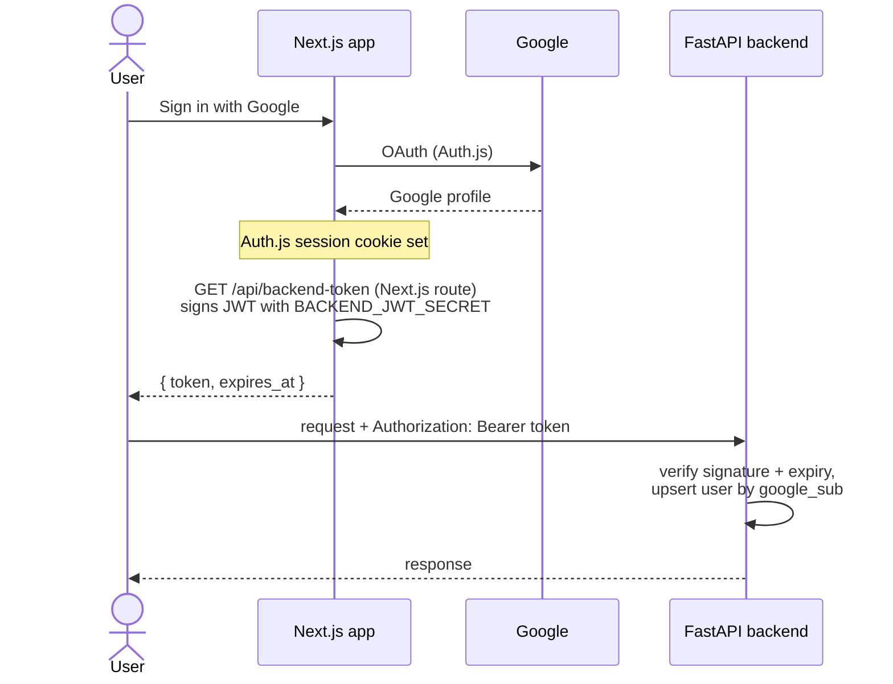

# API

> **Read this first (humans and agents).**
>
> - This is the **source of truth for the backend HTTP API**. Routes, request and response shapes, and error codes must match it. If code needs a change, update this file in the same commit.
> - It follows [ARCHITECTURE.md](ARCHITECTURE.md) and [SCHEMA.md](SCHEMA.md). If they disagree, flag it.
> - FastAPI also generates an OpenAPI spec at `/docs`; this file is the human-readable contract and wins if they differ.
> - Scope is the assignment (v1). Record changes in the [Changelog](#10-changelog).

---

## 1. Conventions

| Topic | Rule |
|---|---|
| Base URL | `https://<backend>/v1` (local: `http://localhost:8000/v1`) |
| Format | JSON, `snake_case` fields, UTF-8 |
| IDs | UUID strings |
| Time | ISO 8601 UTC strings, e.g. `2026-11-04T10:12:03Z` |
| Auth | `Authorization: Bearer <backend token>` on every route except `/health` (§2) |
| Ownership | Every route checks the resource belongs to the signed-in user. Someone else's resource returns **404**, not 403 (don't reveal it exists). |
| Async work | Routes that start work return **202 Accepted** with the task; progress arrives over SSE |
| Lists | Cursor pagination: `?limit=20&before=<cursor>`; response has `next_cursor` (null at the end) |
| CORS | Only `FRONTEND_URL` is allowed |

### Error format
Every error uses the same body:
```json
{
  "error": {
    "code": "task_not_waiting",
    "message": "This task isn't waiting for input.",
    "details": {}
  }
}
```

| HTTP | Common codes |
|---|---|
| 400 | `invalid_request` |
| 401 | `unauthenticated`, `token_expired` |
| 404 | `not_found` |
| 409 | `task_in_progress`, `task_not_waiting`, `stale_card`, `task_finished` |
| 410 | `input_expired` |
| 422 | `validation_error`, `secret_in_message`, `invalid_totp_secret` |
| 429 | `rate_limited`, `too_many_active_tasks` |
| 500 | `internal_error` |
| 503 | `upstream_unavailable` (Claude or Browser Use down) |

---

## 2. Authentication

Google sign-in happens **only in the Next.js app** (Auth.js). The backend never talks to Google. Instead, the Next.js server issues a short-lived **backend token** that the browser sends to the backend.



**Backend token (JWT, HS256):**
| Claim | Value |
|---|---|
| `sub` | Google `sub` (stable user ID) |
| `email`, `name`, `picture` | From the Google profile |
| `iat`, `exp` | Issued at; expires after **15 minutes** |
| `aud` | `"browser-agent-api"` |

- Shared secret `BACKEND_JWT_SECRET` is known only to the Next.js server and the backend.
- The frontend refreshes the token by calling its own `/api/backend-token` before `exp`.
- On first request the backend creates the `users` row (upsert by `google_sub`).

---

## 3. Routes at a glance

| Method | Path | Purpose |
|---|---|---|
| GET | `/health` | Liveness (no auth) |
| GET | `/me` | Current user |
| GET | `/conversations` | List conversations |
| POST | `/conversations` | Create a conversation |
| GET | `/conversations/{id}` | Conversation with messages and tasks |
| DELETE | `/conversations/{id}` | Delete a conversation (cancels its active task) |
| POST | `/conversations/{id}/messages` | Send a message → starts a task |
| GET | `/tasks/{id}` | Task summary |
| GET | `/tasks/{id}/events` | **SSE** stream of task events |
| POST | `/tasks/{id}/input` | Answer a card (OTP, confirm, question, credential ready) |
| POST | `/tasks/{id}/cancel` | Cancel a task |
| POST | `/tasks/{id}/retry` | Resume from checkpoint, or restart |
| GET | `/vault` | Connected accounts (metadata only) |
| POST | `/vault/credentials` | Store a credential |
| DELETE | `/vault/credentials/{id}` | Delete one credential |
| DELETE | `/vault/sites/{site}` | **Revoke** everything for a site |
| POST | `/vault/live-login` | Start a live-view login for a site |
| POST | `/vault/live-login/{id}/complete` | Save the session after the user logged in |
| POST | `/vault/live-login/{id}/cancel` | Abandon a live-view login |
| GET | `/vault/audit` | Audit log |

---

## 4. Users and conversations

### `GET /health`
`200 {"status": "ok"}`

### `GET /me`
```json
{ "id": "…", "email": "adil@example.com", "name": "Adil", "avatar_url": "…" }
```

### `GET /conversations?limit=20&before=<cursor>`
```json
{
  "items": [
    { "id": "…", "title": "Swiggy reorder", "updated_at": "…", "active_task_id": "…" }
  ],
  "next_cursor": null
}
```

### `POST /conversations`
Request: `{}` (title is generated from the first message). Response `201`:
```json
{ "id": "…", "title": null, "created_at": "…" }
```

### `GET /conversations/{id}`
```json
{
  "id": "…",
  "title": "Swiggy reorder",
  "messages": [
    { "id": "…", "role": "user", "content": "Repeat my last Swiggy order", "task_id": "…", "created_at": "…" },
    { "id": "…", "role": "assistant", "content": "Order placed, arriving in 35 min", "task_id": "…", "created_at": "…" }
  ],
  "tasks": [ { "id": "…", "status": "done", "created_at": "…" } ]
}
```
To render a task's progress lines and cards, the frontend opens its event stream (§5).

### `DELETE /conversations/{id}`
`204`. Cancels any active task in it first.

---

## 5. Messages and tasks

### `POST /conversations/{id}/messages`
Sends a user message and starts a task.

Request:
```json
{ "content": "Repeat my last Swiggy order", "client_message_id": "8b6f…" }
```
- `client_message_id`: generated by the frontend; makes retries safe. Re-sending the same one returns the original result instead of starting a second task.

Response `202`:
```json
{
  "message": { "id": "…", "role": "user", "content": "…", "created_at": "…" },
  "task": { "id": "…", "status": "queued", "events_url": "/v1/tasks/…/events" }
}
```

Errors:
- `409 task_in_progress`: this conversation already has an unfinished task (v1: one at a time per conversation).
- `422 secret_in_message`: the content looks like a password, API key, card number or OTP. The message is **not stored**; the frontend shows "Use the secure input instead". An `audit_log` row (`secret_pasted_in_chat`) is written without the value.
- `429 too_many_active_tasks`: user already has 3 unfinished tasks.

### `GET /tasks/{id}`
Summary only. Never returns `checkpoint` or `markers`.
```json
{
  "id": "…",
  "conversation_id": "…",
  "status": "waiting_user",
  "waiting_for": { "kind": "otp", "site": "swiggy.com", "card_seq": 7, "expires_at": "…" },
  "result": null,
  "error": null,
  "attempt": 1,
  "created_at": "…",
  "finished_at": null
}
```

### `GET /tasks/{id}/events` (SSE)
Streams [`task_events`](SCHEMA.md#6-event-types-task_eventstype-and-payload).

- Headers: `Authorization: Bearer …`, optional `Last-Event-ID: <seq>`. (Query `?after=<seq>` also accepted.)
- The browser's built-in `EventSource` can't send headers, so the frontend uses a fetch-based SSE client (e.g. `@microsoft/fetch-event-source`).
- On connect: send every event with `seq > Last-Event-ID` from Postgres, then live events from the relay.
- Every 15 s: a comment line `: ping` to keep proxies from closing the connection.
- After the task reaches `done`, `failed` or `cancelled` and that `status` event is sent, the server closes the stream.

Wire format:
```
id: 7
event: card
data: {"kind":"otp","site":"swiggy.com","title":"Enter the code Swiggy sent to ••••3210","fields":[{"name":"code","type":"otp","length":6}]}

id: 8
event: progress
data: {"text":"Logged in"}
```

### `POST /tasks/{id}/input`
Answers the card the task is waiting on.

Request (one of):
```json
{ "card_seq": 7,  "kind": "otp",              "secret": "482913" }
{ "card_seq": 11, "kind": "confirm",          "data": { "decision": "approve" } }
{ "card_seq": 11, "kind": "confirm",          "data": { "decision": "reject" } }
{ "card_seq": 4,  "kind": "answer",           "data": { "text": "Home address" } }
{ "card_seq": 5,  "kind": "credential_ready", "data": {} }
```
- `secret` is used **only** for OTP codes. It is encrypted on arrival, never logged, never echoed back, and wiped after use.
- `credential_ready` means "I saved the credential" or "I finished logging in through the live view"; the task continues.

Response `202 {"accepted": true}`.

Errors:
- `409 task_not_waiting`: the task isn't in `waiting_user`.
- `409 stale_card`: `card_seq` isn't the card currently being waited on (e.g. an old tab).
- `410 input_expired`: the wait timed out; use `/retry`.

### `POST /tasks/{id}/cancel`
`202 {"accepted": true}`. The task stops at its next safe point and closes its browser; a `status: cancelled` event follows. `409 task_finished` if already finished.

### `POST /tasks/{id}/retry`
Request:
```json
{ "mode": "resume" }
```
- `resume`: continue the same task from its checkpoint (for `failed` with a retryable error, or after `waiting_timeout`). Returns the same task, `202`.
- `restart`: start a **new** task from the same user message, ignoring the old checkpoint. The message moves to the new task. Returns the new task, `202`. Also allowed for `cancelled` tasks.

Response: `202 {"id": "…", "status": "queued", "events_url": "/v1/tasks/…/events"}`.
Errors:
- `409 task_not_retryable`: the task isn't failed/cancelled, or its error isn't retryable (e.g. `access_revoked`).
- `409 task_not_resumable`: limits (`step_limit`, `time_limit`, `cost_limit`) and `too_many_attempts` can only `restart`.
- `409 task_in_progress` / `429 too_many_active_tasks`: same rules as sending a message.

Irreversible-action markers are always honored: a resumed task checks the site before repeating anything (ARCHITECTURE §9.2).

---

## 6. Vault

Values go **in**; only metadata ever comes **out**. Request bodies of vault routes are excluded from all logging.

### `GET /vault`
Connected accounts grouped by site:
```json
{
  "sites": [
    {
      "site": "github.com",
      "credentials": [
        { "id": "…", "kind": "password", "label": "adil@… · GitHub", "created_at": "…", "last_used_at": "…" },
        { "id": "…", "kind": "totp", "label": "Authenticator app", "created_at": "…", "last_used_at": "…" }
      ],
      "session": { "id": "…", "status": "active", "source": "agent_login", "updated_at": "…" }
    },
    {
      "site": "google.com",
      "credentials": [],
      "session": { "id": "…", "status": "active", "source": "live_login", "updated_at": "…" }
    }
  ]
}
```

### `POST /vault/credentials`
Request:
```json
{
  "site": "github.com",
  "kind": "password",
  "secret": { "username": "adil@example.com", "password": "…" },
  "for_task": { "task_id": "…", "card_seq": 5 }
}
```
`secret` shape by `kind` (same as [SCHEMA §3.7](SCHEMA.md#37-credentials)):
- `password`: `{ "username", "password" }`
- `totp`: `{ "secret": "BASE32…" }`. Validated by generating a code; invalid → `422 invalid_totp_secret`.
- `api_key`: `{ "key" }`
- `card`: `{ "number", "expiry", "name" }`. A `cvv` field is rejected (`422 validation_error`).

- `site` is normalized to its registrable domain (`www.github.com` → `github.com`).
- `for_task` (optional): if the credential was requested by a task's card, saving it also wakes that task (same as sending `credential_ready`).
- Saving a kind that already exists for the site **replaces** it.

Response `201` (metadata only):
```json
{ "id": "…", "site": "github.com", "kind": "password", "label": "adil@… · GitHub", "created_at": "…" }
```

### `DELETE /vault/credentials/{id}`
`204`. Writes `credential_revoked` to the audit log.

### `DELETE /vault/sites/{site}`
**Revoke** a site: deletes all its credentials and its session, closes any running browser using them, and writes audit rows. Running tasks that depend on it fail with `access_revoked`. `204`.

### Live-view login (from the Connected accounts page)
For sites where the user should log in themselves (e.g. Gmail). Inside a task this happens through the task's own browser and a `connect` card instead.

**`POST /vault/live-login`**
```json
{ "site": "google.com" }
```
Response `201`:
```json
{ "id": "…", "site": "google.com", "live_view_url": "https://…", "expires_at": "…" }
```
The backend opens a cloud browser at the site's login page. The frontend embeds `live_view_url`; the user logs in.

**`POST /vault/live-login/{id}/complete`**
The backend exports cookies + localStorage, saves them encrypted as the site's session (`source: live_login`), and closes the browser. Response `201`: the session metadata. If the site still looks logged out: `409 not_logged_in`.

**`POST /vault/live-login/{id}/cancel`**
Closes the browser without saving. `204`.

Live-login browsers are closed automatically after 10 minutes.

### `GET /vault/audit?limit=50&before=<cursor>`
```json
{
  "items": [
    { "action": "session_used", "site": "swiggy.com", "kind": "session", "task_id": "…", "at": "…" }
  ],
  "next_cursor": "…"
}
```

---

## 7. Limits

| Limit | Value (v1) | Error |
|---|---|---|
| Messages per user | 10 / minute | `429 rate_limited` |
| Unfinished tasks per user | 3 | `429 too_many_active_tasks` |
| Unfinished tasks per conversation | 1 | `409 task_in_progress` |
| Browser steps per task | 40 | task `failed`, `step_limit` |
| Wall time per task | 10 minutes running (waiting time not counted) | task `failed`, `time_limit` |
| Cost per task | $1.00 | task `failed`, `cost_limit` |
| Waiting for the user | 10 minutes | task `failed`, `waiting_timeout` (Resume available) |
| Live-view login | 10 minutes | browser closed |

---

## 8. Task error codes

Found in `tasks.error.code` and `error` events.

| Code | Meaning | Retryable |
|---|---|---|
| `waiting_timeout` | User didn't answer in time | Yes (resume) |
| `step_limit`, `time_limit`, `cost_limit` | Task hit a limit | Yes (restart) |
| `too_many_attempts` | Crashed and recovered 3 times | Yes (restart) |
| `access_revoked` | User revoked the site mid-task | No |
| `login_failed` | Couldn't log in with the given access | Yes, after fixing access |
| `site_blocked` | Bot detection, CAPTCHA, or region block | No |
| `verification_failed` | Couldn't confirm the result happened | Yes |
| `upstream_unavailable` | Claude or Browser Use unavailable | Yes |
| `internal_error` | Bug | Yes |

---

## 9. Security rules for the API

- Secrets are accepted **only** in `POST /vault/credentials` (`secret`) and `POST /tasks/{id}/input` (`secret`, OTP only). Nowhere else.
- No response ever contains a secret value.
- Request bodies of those two routes are never logged; error messages never include input values.
- Chat messages are scanned for secrets before storing (`422 secret_in_message`).
- HTTPS only in production; CORS limited to the frontend origin.
- 404 for other users' resources.

---

## 10. Changelog

| Date | Change |
|---|---|
| 2026-11-04 | Initial API |
| 2026-11-05 | `/tasks/{id}/retry` response and errors spelled out |
