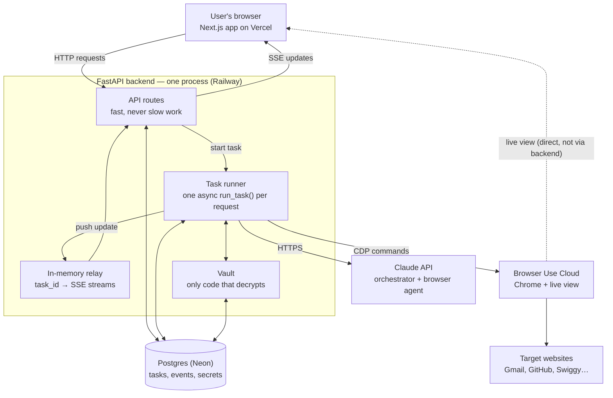
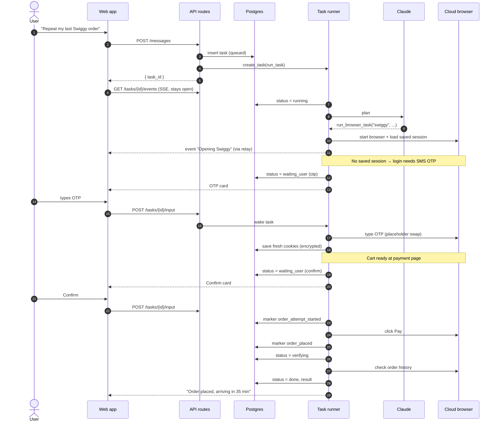
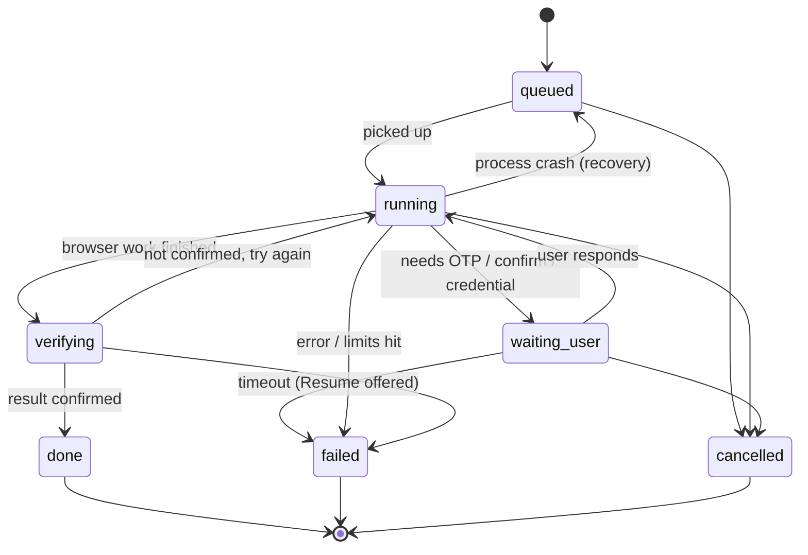
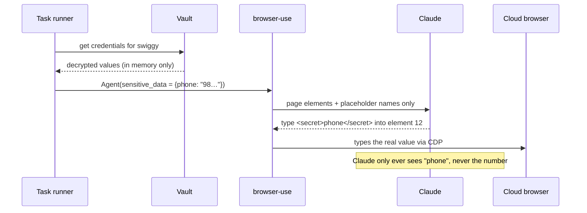
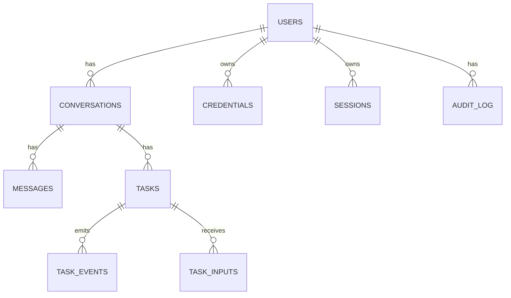

# Architecture

> **Read this first (humans and agents).**
>
> - This file is the **source of truth** for how the system is built. Follow it. If you are about to do something that contradicts it, stop and flag it instead of quietly diverging.
> - It is about **80% confirmed**. Everything not listed under [Open questions](#13-open-questions) is decided.
> - It **will change** as we build. When a decision changes, update this file in the same commit as the code, and add a line to the [Changelog](#14-changelog).
> - Scope is the **assignment (v1)**. Anything under [Scaling path](#11-scaling-path-not-in-v1) is deliberately **not** built now.

Related docs: [PLAN.md](PLAN.md) (requirements, demo scenarios, build phases), [SCHEMA.md](SCHEMA.md) (database), [API.md](API.md) (HTTP API and SSE).

---

## 1. What we're building

A chat assistant. The user asks in plain language ("repeat my last Swiggy order"), and the assistant does it on the real website using a **cloud browser running in the background**. Along the way it collects access safely (login through a live browser view, passwords, TOTP 2FA, SMS OTPs, API keys), stores it for reuse, lets the user revoke it, shows short progress updates, recovers from failures without losing the request, and verifies the result before saying it's done.

**The one rule that shapes everything:** secrets never appear in chat, logs, or anything sent to an LLM.

---

## 2. Key decisions

| Decision | Choice | Why |
|---|---|---|
| Orchestrator | **Our own loop** on the Anthropic SDK (no LangGraph) | Full understanding and control; designed graph-like so LangGraph is easy later |
| Browser agent | **browser-use** (library) | Ready-made perception/action loop; `sensitive_data` placeholders keep secrets from the LLM |
| Browsers | **Browser Use Cloud** | Chrome runs elsewhere (heavy part outsourced), gives live view and proxies |
| Sessions | **Saved by us** (encrypted cookies + localStorage in our DB) | Provider can be swapped; we control revocation |
| Backend runtime | **One FastAPI process, one asyncio event loop**; each task is an async task | Tasks mostly wait on I/O; same pattern as Skyvern. No workers/queue/Redis in v1 |
| Live updates | **SSE** server → client; plain POSTs client → server | Simple, auto-reconnect with `Last-Event-ID` |
| Durable state | **Postgres** for tasks, events, checkpoints, secrets | Survives refresh, crash, redeploy |
| DB access | **SQLAlchemy 2.0 async + asyncpg**, migrations with **Alembic** | Async end to end; standard migrations |
| Secret encryption | **Envelope encryption**, AES-256-GCM, master key in env var | Standard; KMS-ready later |
| App login | **Google sign-in** (Auth.js), app only | Required by the assignment; never used to log into target sites |
| Frontend → backend auth | Next.js server issues a **15-min JWT** (shared secret); browser calls the backend directly with it | Backend never talks to Google; SSE goes straight to the backend (no Vercel function timeouts) |
| LLM | **Claude** for both loops | Default model `claude-opus-5-5`; may drop to Sonnet/Haiku for cost on simple steps |

---

## 3. System overview

---

## 4. Components

### 4.1 Web app — Next.js + Auth.js + Tailwind (Vercel)
- Google sign-in for the app.
- Chat screen that renders **task events** in order, including cards:
  - **Connect account** (log in via live view, or secure form)
  - **Secure input** (password, API key, TOTP setup key, card without CVV)
  - **OTP** (SMS code)
  - **Confirm action** (before anything irreversible)
  - **Retry / Resume**
- Embedded **live browser view** while a task runs.
- **Connected accounts** page: list (metadata only) and revoke.
- Holds **no secrets and no business logic**. Secure inputs post straight to the backend and are never added to chat history.

### 4.2 API routes (FastAPI)
Quick handlers only; they never run a task themselves. Full contract in [API.md](API.md). The main ones:

| Route | Does |
|---|---|
| `POST /v1/conversations/{id}/messages` | Save message, create task (`queued`), start `run_task` in background, return task (202) |
| `GET /v1/tasks/{id}/events` | SSE: replay events after `Last-Event-ID`, then stream live |
| `POST /v1/tasks/{id}/input` | OTP / confirmation / answer / credential ready for a waiting task; wakes it |
| `POST /v1/tasks/{id}/cancel`, `/retry` | Cancel; resume from checkpoint or restart |
| `POST /v1/vault/credentials` | Store a credential (encrypted) |
| `GET /v1/vault` | Connected accounts (metadata only, never values) |
| `DELETE /v1/vault/sites/{site}` | Revoke: delete credentials + session, write audit log |
| `POST /v1/vault/live-login` (+ `/complete`) | Log in yourself through a live view; save the session |

Every route checks the signed-in user owns the resource (404 otherwise).

### 4.3 Task runner
- Started with `asyncio.create_task(run_task(task_id))`; kept in a registry (`task_id → asyncio.Task`) so it can be cancelled and isn't garbage-collected.
- **Everything inside is async** (async Anthropic client, browser-use, async DB driver). One blocking call would freeze every task.
- Inside `run_task`:
  1. **Orchestrator loop** — Claude with tools:
     - `run_browser_task(site, instruction)` — runs browser-use
     - `request_access(site, kind)` — shows a Connect / Secure input card
     - `ask_user(question)` — asks a clarifying question
     - `list_connected_accounts()` — what access exists (metadata only)
  2. **Browser agent loop** — browser-use on a Browser Use Cloud browser, with saved session loaded and secrets as `sensitive_data` placeholders. Custom tools: `fill_totp`, `ask_user_for_code`.
  3. **Verify** the result really happened, save refreshed cookies, reply.
- Limits per task: max browser steps, max wall time, max cost.

### 4.4 In-memory relay
- A dict `task_id → set of open SSE connections`.
- `emit(task_id, event)` = write event to Postgres **then** push to the relay.
- Works only because v1 is a **single process** (see limits).

### 4.5 Vault
- The **only** module that encrypts or decrypts.
- Called by vault routes (encrypt on save) and by the task runner (decrypt just in time).
- See [§8 Secrets](#8-secrets).

### 4.6 External services
- **Claude API** — both LLM loops, over HTTPS.
- **Browser Use Cloud** — one Chrome container per browser session; live view URL; proxy country (needed for Swiggy/India).

---

## 5. Concurrency model

- **1 process → 1 thread → 1 event loop → many async tasks.** No process or thread per task.
- Tasks are **concurrent, not parallel**: they take turns at every `await`. This works because a task spends ~99% of its time waiting on Claude, Chrome, or the user.
- Rough capacity: 20–50 concurrent tasks per process; hundreds of idle SSE connections.
- Waiting for a user (OTP/confirm) costs no CPU; the task awaits an input with a timeout.

---

## 6. Request flow

Example: "Repeat my last Swiggy order".

---

## 7. Task lifecycle

| Status | Meaning |
|---|---|
| `queued` | Created, not started (or re-queued after a crash) |
| `running` | Actively working; heartbeat updated every 10s |
| `waiting_user` | Paused; `waiting_for` says what (`otp`, `confirm`, `credential`, `question`). Browser kept alive; 10 min timeout |
| `verifying` | Checking the result on the site |
| `done` / `failed` / `cancelled` | Finished |

Status is **coarse on purpose** — just enough to know what to do after a crash. Detailed progress goes into events.

### What gets stored per task

| Field | Purpose |
|---|---|
| `status`, `waiting_for` | Where the task is |
| `checkpoint` | How to continue: Claude message history + in-flight step |
| `browser_session_id` | Reconnect to the same cloud browser |
| `heartbeat_at`, `attempt` | Crash detection, retry count (max 3) |
| `markers` | Irreversible actions already started/finished |
| `result`, `error` | Outcome |

---

## 8. Secrets

### 8.1 Ways to give access

| Kind | How it's collected | What we store |
|---|---|---|
| Browser login (e.g. Gmail) | User logs in themselves through the **live view** | Cookies + localStorage only (no password) |
| Password (+ TOTP) | Secure form; TOTP setup key given once | Encrypted password, encrypted TOTP secret |
| SMS OTP | OTP card at the moment it's needed | Nothing long-term (code used once) |
| API key | Secure form | Encrypted key |
| Card | Secure form, **no CVV** | Encrypted card; every payment needs a Confirm |

### 8.2 How a secret is used without the LLM seeing it

TOTP: the `fill_totp(element, site)` tool computes the code and types it; the LLM never sees the code.

### 8.3 Storage — envelope encryption
- Each secret gets a fresh **data key** (AES-256-GCM). The data key is encrypted with the **master key** (`VAULT_MASTER_KEY` env var in v1; KMS later).
- AAD = `user_id|site|kind`, so a ciphertext can't be moved to another user or site.
- `key_version` stored for future key rotation.

### 8.4 Rules
- Vault API is **write-only**: values go in, only metadata comes out.
- Decrypt **just in time, inside the task runner only**. Never log, return, or send decrypted values.
- Keep secrets out of: chat (detect pasted secrets and warn), logs, screenshots on sensitive steps, browser-use history files.
- **Revoke** = delete credentials + sessions, write audit log, close any running browser using them.
- Irreversible actions (send, order, pay, submit) **always** need a Confirm card.

---

## 9. Reliability

### 9.1 Rules for writing state
1. **One transaction per change:** update `tasks` and insert the `task_events` row together.
2. **Push to the relay only after commit.** If a push is lost, the client catches up from `task_events`.
3. **Ownership check on every write** (`WHERE id = ? AND worker_id = ?`), so a stale runner can't overwrite a task taken over by another.
4. **Idempotency markers** for irreversible actions: record `*_started` before, `*_done` after. On recovery, check the site before doing anything.
5. Write one event per **meaningful step**, never per token or click. Big blobs (screenshots) go to object storage, not Postgres.

### 9.2 Crash recovery

| Case | Handling |
|---|---|
| Process dies while `running` | On startup, every `running` task is orphaned → if `attempt < 3`, re-queue and resume from `checkpoint`; else `failed` with Retry. Reconnect to `browser_session_id` if alive, otherwise fresh browser with saved cookies. Tell the agent: "previous attempt was interrupted, check the page first." |
| Dies around an irreversible action | `*_started` set but no `*_done`: check the site (e.g. order history). Found → record and continue. Not found → ask the user before retrying. Never repeat blindly. |
| Dies while `waiting_user` | Nothing lost. On input, resume from checkpoint. If the browser expired, log in again and ask for a fresh OTP. |
| User never answers | Timeout → `failed` (`waiting_timeout`), checkpoint kept, **Resume** button. |
| Claude / Browser Use error | Retry inside the step with backoff (1s, 2s, 4s); then `failed` with a clear message. |
| User refreshes / closes tab | Task keeps running. On reconnect, replay events after the last seen `seq`. |

### 9.3 Verification
Before saying "done", the orchestrator checks the outcome on the site (draft exists, order appears in history, login succeeded). If it can't confirm, it says so instead of claiming success.

---

## 10. Data model (summary)

Full columns, types, indexes, JSON shapes and event types are in [SCHEMA.md](SCHEMA.md).

| Table | Holds |
|---|---|
| `users` | Google account identity |
| `conversations`, `messages` | Chat history (never contains secrets) |
| `tasks` | Current truth per task (§7) |
| `task_events` | Append-only progress log; the chat renders these |
| `task_inputs` | OTPs / confirmations from the user (encrypted, single use) |
| `credentials` | Encrypted passwords, TOTP secrets, API keys, cards |
| `sessions` | Encrypted cookies + localStorage per user per site |
| `audit_log` | Who used / revoked what, when |

---

## 11. Scaling path (not in v1)

| Stage | Change | Capacity |
|---|---|---|
| **v1 (now)** | One process, in-memory relay | Tens of concurrent tasks |
| **v2** | Split API and worker processes; Postgres queue (`FOR UPDATE SKIP LOCKED`) or SQS / Redis Streams for delivery with Postgres for state; Redis pub/sub relay; batched heartbeats | Hundreds–thousands; add workers |
| **v3** | Durable workflows (Temporal / Inngest), KMS, per-user rate limits, self-hosted browser fleet if cost requires | Large scale |

Workers are a **pool of long-running processes**, each running many tasks — not a pod per task. Per-task containers are only needed for the browser (already provided by Browser Use Cloud).

---

## 12. Known limits (v1)

- **Single instance only** — the in-memory relay breaks with more than one backend instance.
- **Redeploys interrupt running tasks** — handled by startup recovery, but the user sees a pause.
- **Master key in an env var**, not KMS.
- Backend must be a **long-running server** (Railway/Render/Fly), not serverless.
- Sites tie sessions to IP/fingerprint; keep the same proxy region per user. Google may block automated password logins (use live-view login).
- No CVV storage; card tokenization not implemented.

---

## 13. Open questions

- [ ] Browser Use Cloud: confirm cookie/localStorage export + import works across fresh browsers (risk spike, PLAN.md step 3).
- [ ] Browser Use Cloud: proxy country setting for Swiggy (India).
- [ ] How the live view embeds (iframe URL, auth, expiry).
- [ ] OpenRouter: what it supports for video generation; fallback task if not.
- [ ] Waiting on the user: keep the coroutine alive with the browser open (current plan) vs. release and resume from checkpoint. Revisit after the spike.
- [ ] Final model choice per loop (Opus vs Sonnet vs Haiku) after measuring cost.

---

## 14. Changelog

| Date | Change |
|---|---|
| 2026-11-04 | Initial architecture (single-process v1, own orchestrator, browser-use + Browser Use Cloud, envelope-encrypted vault, Postgres state) |
| 2026-11-04 | Added SCHEMA.md; chose SQLAlchemy async + asyncpg + Alembic for DB access |
| 2026-11-04 | Added API.md; frontend → backend auth via 15-min JWT from Next.js; routes under `/v1` |
| 2026-11-04 | Phase 4.1 built. Executors plug into the runner through `TaskContext` (fake executor until 4.2). Local dev and tests use Postgres in Docker (port 5433). |
