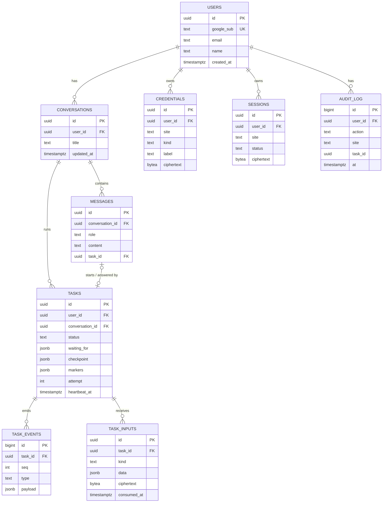

# Database schema

> **Read this first (humans and agents).**
>
> - This is the **source of truth for the database**. Migrations must match it. If code needs a column that isn't here, add it here in the same commit.
> - It follows [ARCHITECTURE.md](ARCHITECTURE.md) (§7 task lifecycle, §8 secrets, §9 reliability). If the two disagree, flag it.
> - Scope is the assignment (v1). Record changes in the [Changelog](#9-changelog).

---

## 1. Conventions

| Topic | Rule |
|---|---|
| Database | Postgres 16+ (Neon) |
| Access | SQLAlchemy 2.0 (async) + `asyncpg`; migrations with **Alembic** |
| Primary keys | `uuid`, generated by the app (so the ID is known before insert, e.g. for encryption AAD). Exception: append-only logs use `bigserial`. |
| Timestamps | `timestamptz`, UTC. Every table has `created_at`; mutable tables also have `updated_at`. |
| Enum-like columns | `text` + `CHECK` constraint (easier to change than Postgres enums) |
| Flexible data | `jsonb`, only where the shape varies (checkpoints, event payloads). Shapes are documented below. |
| Secrets | **Never** in plain columns. Always the five encryption columns (§4). |
| Deletes | Hard delete for credentials and sessions (revocation means gone). `ON DELETE CASCADE` from users. |

---

## 2. Entity diagram



---

## 3. Tables

### 3.1 `users`
One row per Google account that signs into the app.

| Column | Type | Notes |
|---|---|---|
| `id` | uuid PK | |
| `google_sub` | text, unique, not null | Google's stable user ID (not the email) |
| `email` | text, not null | |
| `name` | text | |
| `avatar_url` | text | |
| `created_at` | timestamptz, not null | |
| `last_login_at` | timestamptz | |

### 3.2 `conversations`
A chat thread.

| Column | Type | Notes |
|---|---|---|
| `id` | uuid PK | |
| `user_id` | uuid FK → users, cascade | |
| `title` | text | Auto-generated from the first message |
| `created_at`, `updated_at` | timestamptz | |

Index: `(user_id, updated_at DESC)`.

### 3.3 `messages`
What the user and assistant **said** in chat. Never contains secrets. Claude's internal tool-call history lives in `tasks.checkpoint`, not here.

| Column | Type | Notes |
|---|---|---|
| `id` | uuid PK | |
| `conversation_id` | uuid FK → conversations, cascade | |
| `role` | text, CHECK in (`user`, `assistant`) | |
| `content` | text, not null | |
| `task_id` | uuid FK → tasks, set null | For a user message: the task it started. For an assistant message: the task it reports on. |
| `created_at` | timestamptz | |

Index: `(conversation_id, created_at)`.

### 3.4 `tasks`
**Current truth** for one user request. See ARCHITECTURE §7.

| Column | Type | Notes |
|---|---|---|
| `id` | uuid PK | |
| `user_id` | uuid FK → users, cascade | Ownership check on every route |
| `conversation_id` | uuid FK → conversations, cascade | |
| `status` | text, not null, CHECK in (`queued`, `running`, `waiting_user`, `verifying`, `done`, `failed`, `cancelled`) | |
| `waiting_for` | jsonb | Set **only** when `status = 'waiting_user'` (CHECK). Shape §5.2 |
| `checkpoint` | jsonb | How to resume. Shape §5.1. Never contains secret values |
| `markers` | jsonb, not null, default `{}` | Idempotency markers. Shape §5.3 |
| `browser_session_id` | text | Browser Use Cloud session, for reconnecting |
| `worker_id` | text | Which process owns it (v1: process ID + start time) |
| `heartbeat_at` | timestamptz | Updated every 10s while `running` / `verifying` |
| `attempt` | int, not null, default 0 | Incremented on each (re)start; max 3 |
| `last_event_seq` | int, not null, default 0 | Counter used to number `task_events` |
| `steps_used` | int, not null, default 0 | Browser steps so far (limit check) |
| `cost_usd` | numeric(10,4), not null, default 0 | LLM + browser cost so far (limit check) |
| `result` | jsonb | Final outcome, e.g. `{"order_id": "SW123"}` |
| `error` | jsonb | `{"code": "waiting_timeout", "message": "..."}` |
| `created_at`, `updated_at` | timestamptz | |
| `started_at`, `finished_at` | timestamptz | |

Constraints:
- `CHECK ((status = 'waiting_user') = (waiting_for IS NOT NULL))`

Indexes:
- `(user_id, created_at DESC)`: task list per user
- partial `(status) WHERE status IN ('queued', 'running', 'verifying')`: startup recovery

### 3.5 `task_events`
**Append-only** log of everything the user saw. The chat UI is these rows rendered in order; SSE replay reads from here.

| Column | Type | Notes |
|---|---|---|
| `id` | bigserial PK | |
| `task_id` | uuid FK → tasks, cascade | |
| `seq` | int, not null | 1, 2, 3… per task; the SSE event ID |
| `type` | text, not null, CHECK in event types (§6) | |
| `payload` | jsonb, not null | Shape depends on `type` (§6). Never secrets |
| `created_at` | timestamptz | |

Constraint: `UNIQUE (task_id, seq)` (also serves as the replay index).

### 3.6 `task_inputs`
What the user sends back to a waiting task.

| Column | Type | Notes |
|---|---|---|
| `id` | uuid PK | |
| `task_id` | uuid FK → tasks, cascade | |
| `user_id` | uuid FK → users, cascade | |
| `kind` | text, CHECK in (`otp`, `confirm`, `answer`, `credential_ready`) | |
| `card_seq` | int, not null | The `task_events.seq` of the card being answered (stops stale answers) |
| `data` | jsonb | **Non-secret** values: `{"decision": "approve"}`, `{"text": "home address"}` |
| encryption columns (§4) | nullable | **Secret** values only (OTP codes) |
| `consumed_at` | timestamptz | Set when the task uses it |
| `created_at` | timestamptz | |

Rule: encrypted OTP values are **wiped** (`ciphertext = NULL`) as soon as they're consumed.
Index: `(task_id, consumed_at)`.

### 3.7 `credentials`
Long-lived secrets the user gave us.

| Column | Type | Notes |
|---|---|---|
| `id` | uuid PK | |
| `user_id` | uuid FK → users, cascade | |
| `site` | text, not null | Normalized registrable domain: `github.com`, `swiggy.com`, `openrouter.ai` |
| `kind` | text, CHECK in (`password`, `totp`, `api_key`, `card`) | |
| `label` | text, not null | Safe display text: `adil@… · GitHub`, `Visa ••4242`, `sk-or-…a91f` |
| encryption columns (§4) | not null | |
| `created_at`, `updated_at` | timestamptz | |
| `last_used_at` | timestamptz | |

Constraint: `UNIQUE (user_id, site, kind)` (one of each kind per site in v1; replacing = update).
Encrypted contents by kind:
- `password`: `{"username": "...", "password": "..."}`
- `totp`: `{"secret": "BASE32..."}`
- `api_key`: `{"key": "..."}`
- `card`: `{"number": "...", "expiry": "MM/YY", "name": "..."}` (**no CVV**, ever)

### 3.8 `sessions`
Saved browser login state (cookies + localStorage) per user per site.

| Column | Type | Notes |
|---|---|---|
| `id` | uuid PK | |
| `user_id` | uuid FK → users, cascade | |
| `site` | text, not null | Same normalization as credentials |
| `source` | text, CHECK in (`live_login`, `agent_login`) | User logged in via live view, or the agent logged in with credentials |
| `status` | text, CHECK in (`active`, `expired`) | Set to `expired` when a task finds it logged out |
| encryption columns (§4) | not null | Encrypted Playwright-style `storage_state` JSON (`cookies` + `origins`) |
| `created_at`, `updated_at` | timestamptz | `updated_at` changes every time fresh cookies are saved |
| `last_used_at` | timestamptz | |

Constraint: `UNIQUE (user_id, site)`.

### 3.9 `audit_log`
Append-only record of access to secrets. Survives revocation (no FK to credentials or sessions).

| Column | Type | Notes |
|---|---|---|
| `id` | bigserial PK | |
| `user_id` | uuid FK → users, cascade | |
| `action` | text, CHECK in (`credential_added`, `credential_updated`, `credential_used`, `credential_revoked`, `session_saved`, `session_used`, `session_revoked`, `secret_pasted_in_chat`) | |
| `site` | text | |
| `kind` | text | Snapshot (row may be deleted later) |
| `ref_id` | uuid | ID of the credential or session (no FK) |
| `task_id` | uuid | The task that used it, if any (no FK) |
| `metadata` | jsonb | Non-secret context |
| `at` | timestamptz, not null | |

Index: `(user_id, at DESC)`.

---

## 4. Encryption columns

Used by `credentials`, `sessions`, and (for OTPs) `task_inputs`. See ARCHITECTURE §8.3.

| Column | Type | Meaning |
|---|---|---|
| `ciphertext` | bytea | Secret JSON encrypted with the data key (AES-256-GCM) |
| `nonce` | bytea (12 bytes) | Nonce for the ciphertext |
| `encrypted_dek` | bytea | Data key encrypted with the master key |
| `dek_nonce` | bytea (12 bytes) | Nonce for the data key |
| `key_version` | smallint, default 1 | Which master key version, for rotation |

**AAD** (bound to both encryptions) = `user_id|site|kind`. For sessions `kind = "session"`; for OTP inputs `site` = the task's site, `kind = "otp"`. A ciphertext copied to another user or site fails to decrypt.

---

## 5. JSON shapes

### 5.1 `tasks.checkpoint`
```json
{
  "version": 1,
  "messages": [ "...Claude messages array (user / assistant / tool_use / tool_result)..." ],
  "in_flight": {
    "tool_use_id": "toolu_01...",
    "tool": "run_browser_task",
    "input": { "site": "swiggy.com", "instruction": "Reorder the last order to the same address" }
  },
  "orchestrator_steps": 4
}
```
- Saved after every orchestrator step.
- `in_flight` is set while a tool runs and cleared when its result is appended to `messages`. On recovery, a non-null `in_flight` means "this step was interrupted".
- Contains only placeholders and metadata, **never** secret values.

### 5.2 `tasks.waiting_for`
```json
{ "kind": "otp", "site": "swiggy.com", "card_seq": 7, "expires_at": "2026-11-04T10:15:00Z" }
```
`kind` ∈ `otp`, `confirm`, `credential`, `question`. `card_seq` points at the card event the user must answer.

### 5.3 `tasks.markers`
```json
{
  "swiggy_order": {
    "started_at": "2026-11-04T10:12:03Z",
    "done_at": "2026-11-04T10:12:09Z",
    "ref": "SW123"
  }
}
```
One key per irreversible action. `started_at` without `done_at` after a crash means "check the site before doing anything" (ARCHITECTURE §9.2).

---

## 6. Event types (`task_events.type` and `payload`)

| Type | Payload | UI shows |
|---|---|---|
| `status` | `{"status": "running"}` | Subtle state indicator |
| `progress` | `{"text": "Opening Swiggy"}` | One progress line |
| `live_view` | `{"url": "...", "expires_at": "..."}` | Embedded browser view |
| `card` | `{"kind": "otp" \| "confirm" \| "connect" \| "secure_input" \| "question", "site": "...", "title": "...", "body": "...", "fields": [...]}` | Interactive card |
| `card_resolved` | `{"card_seq": 7, "outcome": "submitted" \| "expired" \| "cancelled"}` | Card greys out |
| `reply` | `{"text": "Order placed, arriving in 35 min", "message_id": "..."}` | Final assistant message |
| `error` | `{"code": "...", "message": "...", "retryable": true}` | Error with Retry/Resume |

The SSE `id:` is `seq`; the SSE `event:` is `type`.

---

## 7. Key queries

**Append an event (one transaction with the state change):**
```sql
UPDATE tasks
   SET status = $status, last_event_seq = last_event_seq + 1, updated_at = now()
 WHERE id = $task_id AND worker_id = $worker_id      -- ownership check
RETURNING last_event_seq;
-- 0 rows → this runner no longer owns the task: stop.

INSERT INTO task_events (task_id, seq, type, payload)
VALUES ($task_id, $returned_seq, $type, $payload);
-- COMMIT, then push to the in-memory relay.
```

**SSE replay after reconnect:**
```sql
SELECT seq, type, payload FROM task_events
 WHERE task_id = $task_id AND seq > $last_event_id
 ORDER BY seq;
```

**Startup recovery (v1):**
```sql
SELECT id, attempt FROM tasks
 WHERE status IN ('queued', 'running', 'verifying');
-- attempt < 3 → claim (set worker_id = me, attempt + 1) and resume from checkpoint
-- else       → status = 'failed', error = {"code": "too_many_attempts"}
```

**Waiting tasks that timed out:**
```sql
SELECT id FROM tasks
 WHERE status = 'waiting_user'
   AND (waiting_for->>'expires_at')::timestamptz < now();
```

---

## 8. Retention

| Data | Kept |
|---|---|
| OTP values in `task_inputs` | Wiped on use |
| `tasks.checkpoint` | Until 7 days after the task finishes (allows Resume), then set to NULL |
| `task_events` | 30 days |
| `audit_log` | Kept (small, needed for trust) |
| `credentials`, `sessions` | Until the user revokes, or deletes their account |

---

## 9. Changelog

| Date | Change |
|---|---|
| 2026-11-04 | Initial schema |
